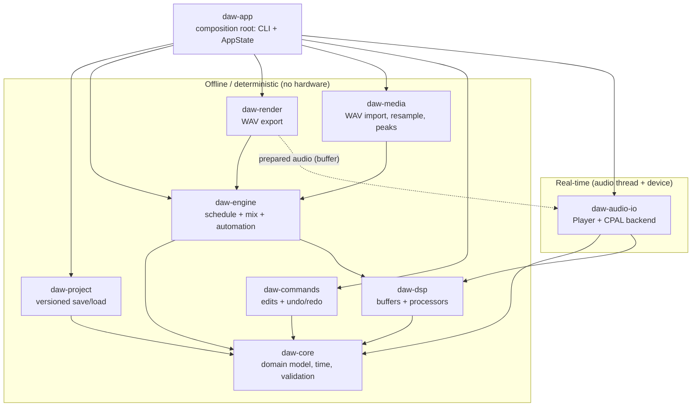
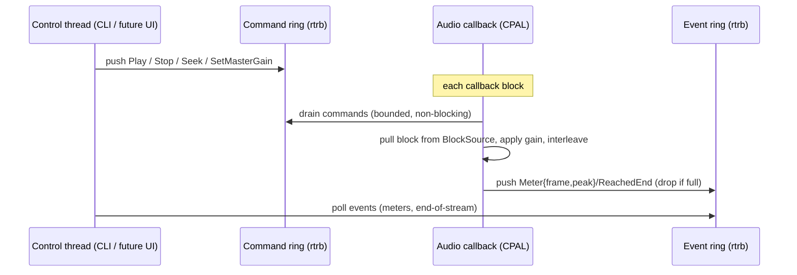
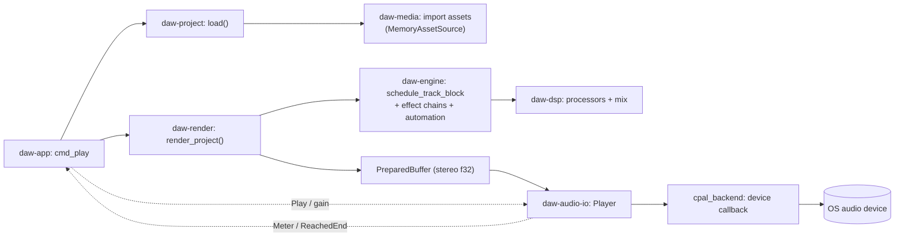
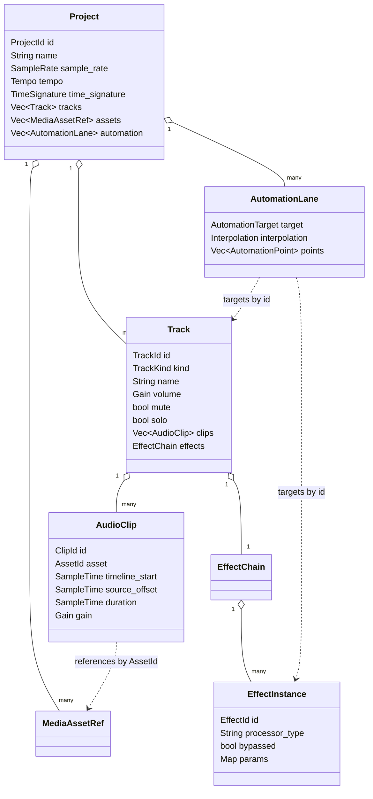

# Free Sound — Architecture

Working name: **Free Sound** (placeholder; not hard-coded anywhere — internal
crates use a neutral `daw-` prefix and the project file uses the magic string
`daw-project`).

This document describes the architecture **as implemented** (offline core
complete; live audio output working). It complements the per-area docs
(`audio-engine.md`, `project-format.md`, `ui.md`) and the decision records under
`docs/adr/`. Diagrams use Mermaid, which GitHub renders inline.

---

## 1. Shape of the system

Free Sound is a **modular monolith** (spec §4): one desktop program split into
small Rust crates with strict, compiler-enforced boundaries. Dependencies only
ever point toward `daw-core`; there are no cycles.

A useful way to read the system is as two cooperating halves joined by a narrow
seam:

- **Offline / deterministic half** — the domain model, DSP, editing, and the
  render/import/export path. Fully testable with no audio hardware (all 219
  tests run here).
- **Real-time half** — the audio device and the real-time-safe player.

The dotted edge is the **seam**: the real-time player consumes audio produced by
the offline render path (currently a pre-rendered buffer) and is otherwise
driven only by lock-free control messages. The two halves never share mutable
state directly.

---

## 2. Layers (spec §4.1) and where they live

| Spec layer | Crate(s) | Responsibility |
|---|---|---|
| Domain / core | `daw-core` | IDs, time, audio value types, project/track/clip/effect/automation model, validation |
| Project / session | `daw-project` | versioned document, save/load, migrations, missing-media |
| Application services | `daw-app` | commands orchestration, CLI, `AppState` shell |
| Commands / undo | `daw-commands` | reversible edits + history (gesture grouping) |
| Audio engine | `daw-engine` | clip scheduling, effect chains, automation, offline mix |
| DSP | `daw-dsp` | buffers + processors (gain, pan, distortion, filter, delay, reverb, EQ, compressor, mixer) |
| Rendering / export | `daw-render` | offline WAV export (reuses the engine) |
| Media import | `daw-media` | WAV decode, resampling, waveform peaks |
| Platform adapters | `daw-audio-io` | CPAL output behind a trait; real-time player + lock-free rings |
| UI | `daw-app` (CLI today; egui pending ADR-0002) | present state, drive commands/transport |

---

## 3. Crate boundaries and their public contracts

Each crate exposes a small, deliberate surface. The compiler enforces that a
crate can only use what it depends on, so these boundaries are structural, not
conventions.

### daw-core — the stable "narrow waist"
Depends on nothing internal. Public: `Project`, `Track`/`TrackKind`,
`AudioClip`, `MediaAssetRef`, `EffectChain`/`EffectInstance`/`ParamValue`,
`AutomationLane`/`AutomationTarget`/`AutomationPoint`/`Interpolation`, the id
newtypes (`ProjectId`, `TrackId`, …), the time model (`SampleTime`,
`MusicalTime`, `SampleRate`, `Tempo`, `TimeSignature`, `PPQ`), audio value types
(`Sample`, `ChannelLayout`, `Gain`), and `Validate`/`ValidationError`.
Contains **no** GUI, device, DSP-algorithm, or file-format types.

### daw-dsp — pure signal processing
Public: `AudioBuffer`, `AudioProcessor`/`ProcessConfig`, and the processors
(`GainProcessor`, `PanProcessor`, `DistortionProcessor`,
`FilterProcessor`/`FilterMode`, `DelayProcessor`, `ReverbProcessor`,
`EqBand`/`EqBandType`, `CompressorProcessor`), plus `mix_into`. Knows nothing
about tracks, projects, files, or time.

### daw-project — persistence
Public: `save`/`load`/`to_json`/`from_json`, `ProjectDocument`,
`CURRENT_SCHEMA_VERSION`/`FORMAT_MAGIC`, `migrate_to_current`, `ProjectError`,
and missing-media helpers (`find_missing_media`, `relink_asset`,
`MissingMedia`). The on-disk schema is a dedicated versioned type, never raw
internal structs.

### daw-commands — editing + undo/redo
Public: `Command` trait, `History`, `Transaction`, `CommandError` (concrete
commands live in `commands::*`). Mutates the domain model and inverts itself;
touches no audio or files.

### daw-engine — processing orchestration
Public: `render_block`/`RenderError`, `schedule_track_block`/`AssetSource`/
`project_length_frames`, `process_chain`/`build_processor`/`ProcessorChain`,
`automated_project`. This is where **core (what)** meets **dsp (how)**.
`AssetSource` is the key seam for media: the engine reads samples through it
without knowing about files.

### daw-render / daw-media — I/O at the edges
`daw-render`: `export_wav`/`render_project`/`ExportOptions`, `write_wav`/
`WavFormat`. `daw-media`: `import_wav`/`import_wav_at`/`MemoryAssetSource`,
`decode_wav`/`DecodedAudio`, `resample_*`, `compute_peaks`/`WaveformPeaks`.
Both reuse the engine render path.

### daw-audio-io — the real-time / device boundary
Public: `BlockSource`/`PreparedBuffer`, `Player`/`Transport`,
`PlaybackHandle`, `Command`/`Event`, and `CpalOutput`/`AudioOutput`/
`DeviceError`. **CPAL is confined to one module** (`cpal_backend`) behind the
`AudioOutput` trait; no device-library type appears anywhere else.

### daw-app — composition root
The only crate allowed to see everything. Hosts the `daw` binary (CLI +
`AppState`). The future egui frontend lives here, so it cannot leak toolkit
types into the lower crates.

---

## 4. Interface-ownership rules (spec §4.3) — enforced by structure

| Rule | How it is enforced |
|---|---|
| Core carries no GUI types | `daw-core` depends on no UI crate; GUI will live in `daw-app` |
| Core carries no audio-device types | CPAL exists only in `daw-audio-io::cpal_backend`, behind `AudioOutput` |
| Project format is not raw Rust layout | `daw-project` defines a versioned `ProjectDocument`, decoupled from `Project` |
| DSP doesn't know about tracks/UI | `daw-dsp` depends only on `daw-core` value types |
| A processor doesn't do disk I/O | processors operate on `AudioBuffer`; I/O lives in render/media |
| Platform code is localized | all CPAL in one file; all file I/O in project/render/media |
| `#![forbid(unsafe_code)]` | set on every crate |

---

## 5. Threading & real-time model (ADR-0007)

The offline half runs synchronously on whatever thread calls it (the CLI's main
thread, test threads). The real-time half runs on the OS audio callback thread.
They are joined only by two **bounded, lock-free SPSC rings** (`rtrb`):

Rules the audio callback obeys (reviewed + covered by hardware-free tests): no
allocation, no locking, no I/O, no blocking, bounded work. All scratch is
preallocated in `Player::new`; the event ring drops on full rather than ever
blocking the audio thread.

**Current scope:** output only, playing a pre-rendered `PreparedBuffer`.
Deferred (ADR-0007): a prepared-graph swap for live effect edits during
playback, and a capture ring for recording.

---

## 6. End-to-end flow: `daw play song.json`

What touches a sample from command to speaker:

1. CLI loads the project (`daw-project`) and imports referenced WAVs
   (`daw-media`).
2. The whole project is rendered offline at the **device sample rate**
   (`daw-render` → `daw-engine` → `daw-dsp`) into a stereo buffer.
3. The buffer becomes a `PreparedBuffer` handed to the `Player`.
4. `CpalOutput::start` runs the player from the device callback; the CLI sends
   `Play` and polls `Meter`/`ReachedEnd` over the rings.

The same offline steps 1–2 are exactly what `daw export` writes to a file — the
render path is shared, so live and offline output are consistent by
construction.

---

## 7. Data model at a glance

References are always by **stable id**, never by array index or name — names and
order can change without breaking references (spec §5). Validation checks that
every clip's `asset` and every automation target resolves (dangling-reference
detection).

Persistence: this model serializes to a versioned `ProjectDocument` (schema v4,
JSON) with step-wise migrations (v1→v2→v3→v4) and atomic save (write-temp-then-
rename). See `project-format.md`.

---

## 8. What is deliberately not here yet

- **GUI** — egui chosen (ADR-0002, pending prototype); will live in/above
  `daw-app`.
- **Recording & MIDI** — later milestones (`daw-midi` not yet created).
- **Live editing during playback** — needs the prepared-graph swap (ADR-0007).
- **Compressed import, streaming decode** — `symphonia` deferred (ADR-0011).

The boundaries above are designed so each of these slots into an existing seam
(a new crate above the engine, a `BlockSource`/`AssetSource` implementation, or
a presenter over `AppState`) without disturbing the stable core.
